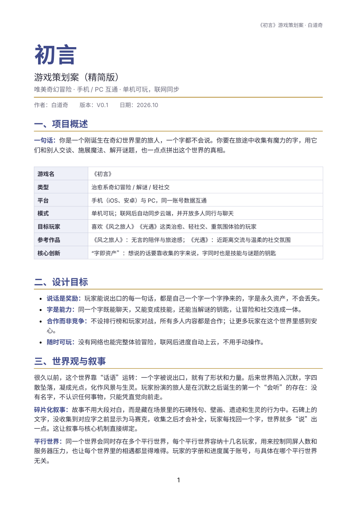

# 《初言》游戏策划案


**▶ [完整策划案 PDF（5 页）](初言_游戏策划案.pdf)**

> 你是一个刚诞生在奇幻世界里的旅人，一个字都不会说。你要在旅途中收集有魔力的字，
> 用它们和别人交谈、施展魔法、解开谜题，也一点点拼出这个世界的真相。



作者：白道奇　版本：V0.1　日期：2026.10

## 核心创新：字即资产

想说的话要靠收集的字来说，字同时是技能与谜题的钥匙。一个字贯穿了**社交、战斗、解谜**三条线，
让冒险和社交连成一体，而不是各自独立。

- **说话是奖励**：能说出口的每一句话，都是一个字一个字挣来的；字是永久资产，不会丢失
- **字是能力**：同一个字既能聊天，又能变成技能，还能当解谜钥匙
- **合作而非竞争**：不设排行榜与玩家对战，所有多人内容都是合作

## 字的获取与分类

五条来源：探索、解谜、剧情、合作、更新活动。字按用途分为基础字 / 元素字 / 物象字 /
动作字 / 情感字 / 语气字六类，另有常见、珍稀、传说三档稀有度（只影响获取难度，
不影响聊天显示）。

## 聊天显示规则

玩家可输入任何文字，系统**逐字判断**：已收集的字对方正常看到，未收集的字显示为马赛克。

| 已收集 | 输入 | 对方看到 |
|---|---|---|
| 你、好、去、光 | 你好，今天去看光吧 | 你好，▇▇去▇光▇ |

由此自然产生三种体验：新人进频道满屏马赛克 → 用手里有限的字想办法表意 → 缺字时有了去探索的动力。
同时因为「只有收集过的字才显示」，策划可控制字的投放节奏，天然具备内容安全优势。

## 字的魔力：组合施法

消耗「字力」（初始上限 100）施法，单字效果简单，组合效果完整。配方由策划预设，玩家通过尝试发现：

| 组合 | 技能 | 效果 | 字力 |
|---|---|---|---|
| 冰 + 球 | 冰球 | 投出冻结小型目标，可砸碎薄冰 | 25 |
| 冰 + 柱 | 冰柱 | 升起冰柱，作垫脚石或挡板 | 30 |
| 风 + 翼 | 风翼 | 展开风之翼，滑翔越过缺口 | 35 |
| 木 + 桥 | 木桥 | 在缺口处搭桥，持续一段时间后消散 | 40 |
| 花 + 开 | 花开 | 催生花丛作踏板，可安抚生灵 | 25 |

## 解谜原则：一道谜题至少两种解法

以「冰镜湖缺口」为例：冰+柱升起冰柱垫脚 / 冰+球冻结水面走过去 / 风+翼滑翔越过。
字不够的玩家可先去别处补字再回来。

游戏没有传统战斗与血量：每种生灵有习性与弱点，被碰到只损失部分字力并送回篝火，
**不掉字、无死亡惩罚**。

## 章节规划

| 章节 | 主题 | 新增字类型 | 核心谜题 |
|---|---|---|---|
| 序章 苏醒之原 | 新手教学 | 基础字、少量元素字 | 用「光」照亮、用「走」开路 |
| 第一章 冰镜湖 | 元素与组合 | 冰、水、柱、球 | 多解法的水面缺口 |
| 第二章 无声城 | 碎片叙事 | 情感字、动作字 | 石碑残句补全 |
| 第三章 风之回廊 | 合作冒险 | 风、翼、合作字 | 需两人以上同时施法 |

## 社交与多人

- **近距离聊天**：场景内靠近可发送气泡消息，范围内可见
- **言灵终端**：随身终端，含字册、好友私聊、全局频道（100 字 + 通关第一章解锁）
- **合作施法**：队友各出一个字拼成组合技能，如 A 出「冰」+ B 出「球」= 冰球
- **平行世界**：每个世界容纳十几名玩家，控制同屏人数，也让相遇显得难得

## 单机 / 联网与数据同步

离线可完整体验冒险与解谜；联网后自动上云，不需手动操作。合并规则：字册与配方取并集
（字永不丢失）、剧情进度取更靠后、设置取最近修改。手机与 PC 同账号互通。

## 待定与可调整项

汉字总量（首版几百个）、字力数值、全局频道门槛、平行世界人数、美术风格（暂定水彩治愈风）、
首批配方数量（约 40–60 条）——均会在原型测试后调整。

## 目录

```
初言_游戏策划案.pdf    完整策划案（5 页）
docs/preview.png       首页预览图
```
